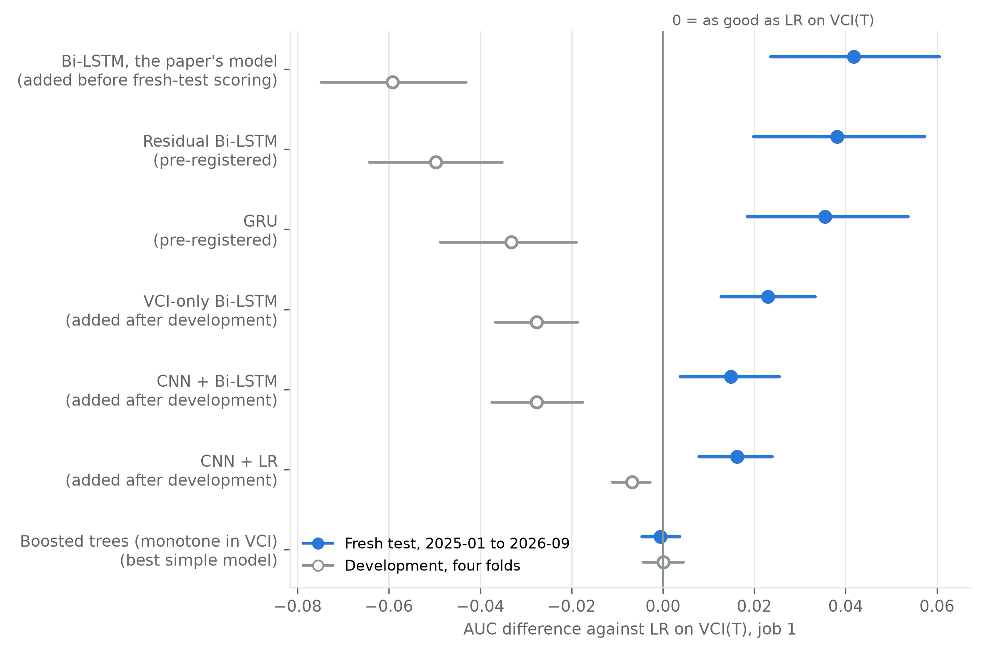
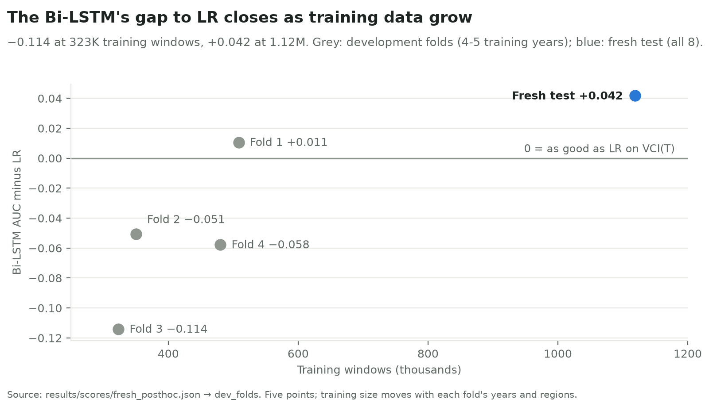
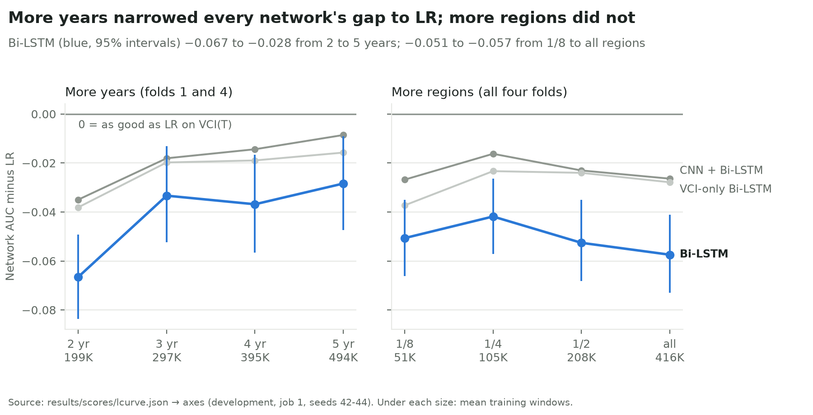
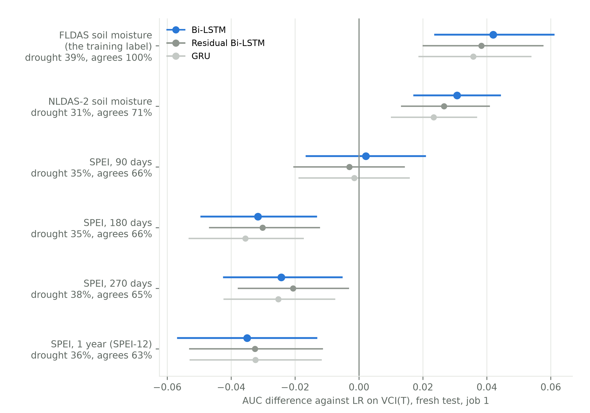
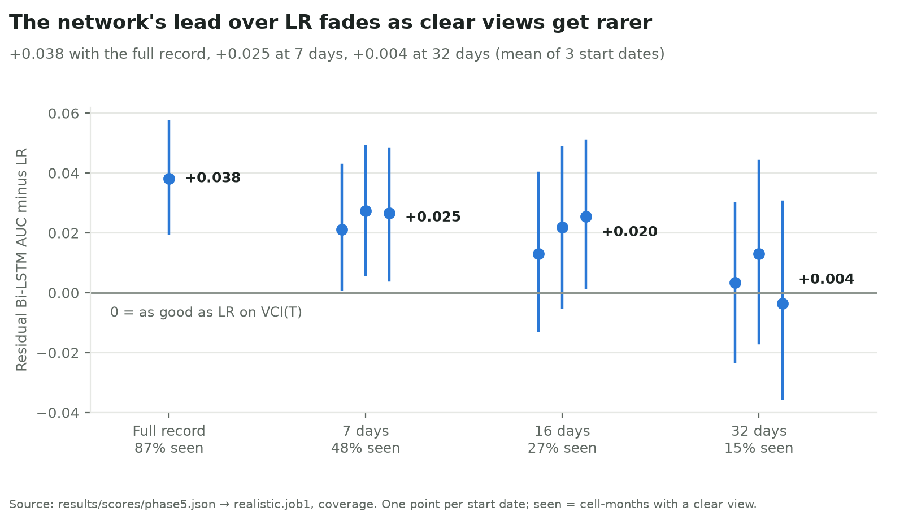
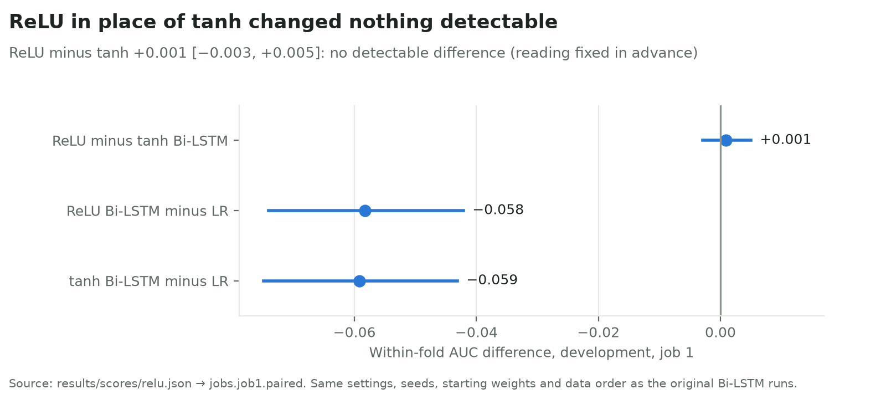

# DEWSat drought model: findings

**Question:** does a network that reads 12 months of satellite inputs (a Bi-LSTM) rank this month's drought better than
logistic regression on this month's Vegetation Condition Index, LR on VCI(T)?

**Answer: yes, for soil-moisture drought on the one-time fresh test, with conditions.** Trained on all eight development
years and scored once on 144 regions never used in development, the Bi-LSTM reached AUC 0.663 against LR's 0.621, a
difference of +0.042 [+0.024, +0.060]. In development, with four or five training years per fold, every network trailed
LR.

The Bi-LSTM is the plain network, the model the DEWSat paper uses, and it leads every section below. For job 1 it is not
a pre-registered row: it was added to the single fresh-test scoring before any fresh-test label was read (DESIGN.md
amendment 6). Job 1's pre-registered networks, the residual Bi-LSTM (LR on VCI(T) plus a Bi-LSTM correction) and the
GRU, both passed the rule fixed before training: +0.038 [+0.020, +0.057] and +0.035 [+0.019, +0.054]. The three are
within 0.006 AUC of each other on the fresh test.

Brackets are 95% intervals from 2,000 resamples of whole regions. Every number here is in `results/` (tables, figures,
score files); `report.md` has every table of the run. Figures 1 and 4 here are the Bi-LSTM-led versions in
`paper_results/figures/`; the versions in `results/figures/` lead with the residual Bi-LSTM.

## What we tested

| Part | Setup |
| --- | --- |
| Label | A cell-month is in drought when FLDAS Noah soil moisture at 10-40 cm is below the cell's calendar-month 20th percentile (2001-2022) |
| Inputs | 12 monthly steps, 9 channels each: NDVI mean and spread, VCI mean and 10th percentile, clear fraction, season (sine and cosine), an observed flag, months since the last view. From HLS v2.0 (Landsat 8/9 and Sentinel-2) Red and NIR composites, standing in for DEWSat's camera |
| Data | Development: 558 regions (13,977 cells of 0.1 degrees), 2016-2023. Fresh test: 144 new regions (3,600 cells), each at least 0.5 degrees from every development region, target months 2025-01 to 2026-09 |
| Jobs | 1: estimate this month's drought. 2: the same with this month's view missing. 3: forecast drought onset 1-3 months ahead. 4: job 1 where VCI changed most |
| Models | Simple: climatology, LR on VCI(T), LR on the latest VCI and its age, LR with trend features, boosted trees monotone in VCI, a smoothed-VCI state model. Networks: Bi-LSTM, residual Bi-LSTM (starts at the LR), GRU, one-direction LSTM, temporal CNN. A 30-setting search per network, fold and job, then 10 seeds |
| Folds | 4 outer folds, each a region group crossed with a two-year block (2016-17, 2018-19, 2020-21, 2022-23), with 12-month buffers; each fold trains on 4-5 years and three quarters of the regions |
| Scoring | Within-fold AUC; paired differences on the same windows; West and East of 98 degrees W reported apart |
| Pass rule | The all-regions interval is above zero, and neither the West nor the East interval is entirely below zero |
| Pre-registration | The design and the pass rule were committed before any training (`code/design/DESIGN.md`, `gate.json`, commit of Nov 7, 2026, 03:31). Later additions are dated amendments, each committed before its runs |
| Fresh test | Its labels were locked until Phase 5 and scored once (Nov 9, 2026, 09:36); the scorer refuses a second scoring |

## Results

### 1. Development: LR won every pre-registered comparison

| Job | Best network − best simple model (the gate) | Verdict |
| --- | --- | --- |
| 1, estimate now | GRU − boosted trees: −0.033 [−0.047, −0.020] | worse |
| 2, missing month | GRU − boosted trees: −0.075 [−0.112, −0.038] | worse |
| 3, onset forecast | GRU − LR with trend features: −0.036 [−0.053, −0.019] | worse |
| 4, VCI changed most | GRU − boosted trees: −0.034 [−0.051, −0.017] | worse |

On job 1, LR on VCI(T) scored 0.686 against the Bi-LSTM's 0.627, the residual Bi-LSTM's 0.636 and the GRU's 0.653.
Against LR, the Bi-LSTM trailed by −0.059 [−0.075, −0.043] and the residual Bi-LSTM by −0.050 [−0.064, −0.035]. Three models added after these results
(a VCI-only Bi-LSTM, and a CNN on per-pixel VCI tiles feeding LR or a Bi-LSTM) also trailed LR.

Tables: `results/tables/development_gate.csv`, `development_auc_job1.csv`.

### 2. Fresh test: the Bi-LSTM and both pre-registered networks beat LR on job 1

| Job | Comparison | All regions | West | East | Verdict |
| --- | --- | --- | --- | --- | --- |
| 1 | Bi-LSTM − LR on VCI(T) (added before scoring; not a gate row) | +0.042 [+0.024, +0.060] | +0.013 [−0.008, +0.035] | +0.037 [+0.010, +0.061] | meets the pass rule |
| 1 | Residual Bi-LSTM − LR on VCI(T) | +0.038 [+0.020, +0.057] | +0.019 [−0.001, +0.041] | +0.028 [+0.000, +0.054] | passed |
| 1 | GRU − LR on VCI(T) | +0.035 [+0.019, +0.054] | +0.016 [−0.004, +0.036] | +0.026 [+0.001, +0.049] | passed |
| 1 | GRU − boosted trees (gate) | +0.036 [+0.019, +0.054] | +0.022 [+0.001, +0.044] | +0.009 [−0.014, +0.030] | passed |
| 2 | GRU − boosted trees (gate) | +0.002 [−0.038, +0.042] | +0.047 [+0.006, +0.095] | −0.035 [−0.091, +0.020] | no detectable difference |
| 3 | Bi-LSTM − LR with trend features | +0.038 [+0.007, +0.069] | +0.062 [+0.013, +0.113] | −0.025 [−0.059, +0.009] | passed |
| 4 | GRU − boosted trees (gate) | +0.051 [+0.027, +0.075] | +0.021 [+0.002, +0.041] | +0.028 [−0.011, +0.063] | passed |

Job 1 AUCs (65,170 windows, 39.5% in drought): Bi-LSTM 0.663, residual Bi-LSTM 0.659, GRU 0.657, LR on VCI(T) 0.621.
For job 1 the Bi-LSTM was added to the fresh test before it was scored; the GRU and the residual Bi-LSTM were the
pre-registered rows. In job 3 the Bi-LSTM is the pre-registered best Bi-LSTM variant. Job 3's pass is not a usable forecast: every model's mean onset AUC is at most
0.54. All rows: `results/tables/fresh_test_verdicts.csv`, `fresh_test_auc.csv`.

### 3. Why development and the fresh test disagree: years of training data

Across the four development folds and the fresh test, the Bi-LSTM's gap to LR follows its training data, from −0.114
at 323K windows to +0.042 at 1.12M.

The learning curve separates the two kinds of extra data. Going from two to five training years narrowed the Bi-LSTM's
gap from −0.067 to −0.028, and it was still narrowing from four to five years: +0.008 [+0.004, +0.014] (CNN + Bi-LSTM
+0.006, VCI-only Bi-LSTM +0.003, both intervals above zero). Eight times as many windows from more regions narrowed none
of the three gaps.

A straight line through the years curve reaches only about zero at eight years, short of the fresh test's +0.042, so the
extra years may not account for the whole gain. Tables: `results/tables/training_size.csv`, `learning_curve.csv`,
`learning_curve_changes.csv`.

### 4. The gain is about soil-moisture drought

The same saved fresh-test predictions, scored against other drought labels on the 64,995 windows where all of them
exist: the gain holds against a second soil-moisture model (NLDAS-2 Noah, 10-40 cm) and disappears or reverses against
climatic drought (gridMET SPEI). FLDAS and NLDAS-2 agree on 81% of drought flags in development and 71% in the fresh
period.

Bi-LSTM − LR: NLDAS-2 +0.031 [+0.017, +0.044]; SPEI over 90 days +0.002 [−0.016, +0.021]; over 180 days (chosen on
development data) −0.032 [−0.049, −0.013]; over 270 days −0.024 [−0.042, −0.005]; over 1 year (SPEI-12, scored after
the lock) −0.035 [−0.057, −0.013]. Residual Bi-LSTM − LR: NLDAS-2 +0.027 [+0.013, +0.041]; SPEI 90 days −0.003
[−0.020, +0.014]; 180 days −0.030 [−0.047, −0.012]; 270 days −0.021 [−0.038, −0.003]; 1 year −0.033 [−0.053, −0.011].
Tables: `results/tables/other_labels.csv`, `paper_results/tables/T4_other_labels_job1.csv` (with SPEI-12).

### 5. The gain needs frequent clear views

With single clear views instead of monthly composites, the networks' lead shrinks with the revisit interval. A pass sees
a cell only when at least 30% of it is clear that day. The models were trained on composites; each range below spans
three start dates.

| One clear view every | Bi-LSTM − LR | Residual Bi-LSTM − LR | GRU − LR |
| --- | --- | --- | --- |
| Full record (monthly composites) | +0.042 [+0.024, +0.060] | +0.038 [+0.020, +0.057] | +0.035 [+0.019, +0.054] |
| 7 days | +0.012 to +0.020 (0 of 3 intervals above zero) | +0.021 to +0.027 (3 of 3) | +0.021 to +0.025 (3 of 3) |
| 16 days | −0.005 to +0.021 (0 of 3) | +0.013 to +0.026 (1 of 3) | +0.005 to +0.023 (1 of 3) |
| 32 days | −0.032 to +0.019 (0 of 3) | −0.004 to +0.013 (0 of 3) | −0.014 to +0.020 (0 of 3) |

The Bi-LSTM is the least robust of the three: its intervals include zero even at 7 days. The figure plots the residual
Bi-LSTM and GRU only.

The GRU retrained on thinned development data behaves the same: mean AUC, LR against GRU, 0.625 / 0.645 at 7 days,
0.640 / 0.661 at 16 days, 0.641 / 0.647 at 32 days; this retraining was run only for the GRU. Tables:
`results/tables/revisit.csv`, `paper_results/tables/T5_revisit_job1.csv`.

### 6. What matters is the inputs, not the architecture

| Comparison | Result | Reading |
| --- | --- | --- |
| Full-input Bi-LSTM − VCI-only Bi-LSTM, fresh test | +0.019 [+0.006, +0.032] | the gain needs NDVI level and spread, clear fraction and season |
| Within regions over time, network − LR, fresh test | Bi-LSTM +0.031 [+0.016, +0.045]; VCI-only Bi-LSTM +0.003 [−0.006, +0.012] | same |
| Per-pixel VCI tiles − cell averages, 12 months, fresh test | −0.008 [−0.016, +0.000] | image tiles add nothing |
| NDMI added (needs SWIR), development | +0.002 [−0.005, +0.009] | no gain |
| Weekly inputs (52 weekly single views): GRU − LR on the latest VCI and its age, development | −0.018 [−0.033, −0.003] | the network gains nothing from weekly views |
| Bi-LSTM − GRU; Bi-LSTM − residual Bi-LSTM, fresh test | +0.006 [+0.002, +0.011]; +0.004 [−0.001, +0.009] | the recurrent networks are nearly tied |
| ReLU in place of tanh inside the Bi-LSTM, development | +0.001 [−0.003, +0.005] | no detectable difference |

The ReLU test (design amendment 7) kept each fold's settings, the 10 seeds, the starting weights and the data order of
the original Bi-LSTM runs; only the activation of the candidate memory and the output changed. Tables:
`results/tables/image_vs_cell_average.csv`, `whatifs_and_weekly.csv`, `fresh_network_pairs.csv`,
`fresh_within_region.csv`, `relu.csv`, `relu_per_fold.csv`.

### 7. Checks on the networks

- **Positive control:** on a synthetic label only history explains (VCI fell by more than 20 points in three months),
  LR on VCI(T) scored 0.820 and the networks 0.982 to 1.000: the networks and their training code can learn history.
- **Order test:** shuffling months T-11 to T-1 did not lower any network's development AUC; the Bi-LSTM's rose by
  +0.022 [+0.010, +0.035]. In development the networks did not use the order of the earlier months.
- **Reproducibility:** 13 saved fresh-test networks reproduce their scored outputs to within 2.9e-6; CPU runs reproduce
  exactly and GPU runs to about 1e-6.

Tables: `results/tables/positive_control.csv`, `order_test.csv`.

### 8. Model size for the Jetson Orin Nano

| Job 1 model | Setting | Parameters | Multiply-adds per prediction | Weights (float32) |
| --- | --- | --- | --- | --- |
| Bi-LSTM | hidden 24, 1 layer | 11,617 | 80,688 | 49.5 KiB |
| Residual Bi-LSTM | hidden 24, 1 layer | 11,617 | 80,688 | 49.5 KiB |
| GRU | hidden 32, 1 layer | 16,833 | 102,720 | 69.8 KiB |
| CNN + Bi-LSTM | hidden 16, CNN width 16, depth 3 | 23,217 | 13,030,048 | 95.9 KiB |

Each reported result averages 10 seeds (copies): for the Bi-LSTM about 495 KiB of weights and 806,880 multiply-adds
per prediction, above the 30-100 KB range that one copy (49.5 KiB) fits; in
development one seed alone scores 0.001-0.013 AUC below the 10-seed average per fold. The networks were trained directly
on the labels; an earlier run found that distilling from a large teacher gave no small model an advantage over direct
training. The saved models are in `runs/phase5/composite/<job>/<model>/seed<s>/` (`model.pt`, `meta.json`); no INT8,
ONNX or TensorRT export has been made yet. Table: `results/tables/model_sizes.csv`.

### 9. Compared with the earlier paper run

| | Earlier run (Oct 2026) | This study (Nov 2026) |
| --- | --- | --- |
| Regions | 102, of them 22 test regions | 558 development + 144 fresh-test regions |
| Test | 2024-01 to 2026-09, 15,347 windows | 2025-01 to 2026-09, 65,170 windows |
| Bi-LSTM − LR on VCI(T), test | −0.005 [−0.049, +0.038] | +0.042 [+0.024, +0.060] (pre-registered residual Bi-LSTM +0.038 [+0.020, +0.057]) |
| Decision | LR as the headline, the Bi-LSTM to future work | passed the pre-registered rule, with conditions |

## What it means

1. **A qualified yes:** with eight years of training data, a small recurrent network on 12 months of Red/NIR-derived
   inputs ranks current-month soil-moisture drought better than VCI alone, by about 0.04 AUC, on unseen regions.
2. **It is data-hungry:** with four or five training years it lost; the learning curve points to years of record, and
   the earlier run's tie fits that.
3. **The inputs matter, not the architecture:** GRU, residual and plain Bi-LSTM are within 0.006, and ReLU matches tanh.
4. **The scope is narrow:** soil-moisture drought, with a clear view about every week; no gain for the missing month
   and no usable onset forecast.
5. **It fits the Orin Nano easily:** about 12,000 parameters and 80,000 multiply-adds per copy.

## Limitations

- **One test period:** 21 months, unusually dry (39.5% of job-1 windows in drought against 23.0% in development; 22.1%
  of all labelled development cell-months); region
  resampling cannot show how another period would differ.
- **Development and the fresh test disagree:** the training-size explanation rests on five points, and training size
  moves with which years and regions each fold trained on.
- **The label is a model:** FLDAS Noah soil moisture, not ground observations.
- **Rows added after development:** for job 1 the Bi-LSTM (the paper's model), the VCI-only Bi-LSTM and the CNN models
  were added after the development results and before the fresh test was scored; only the GRU and the residual
  Bi-LSTM were pre-registered. The three recurrent networks are within 0.006 AUC on the fresh test, so leading with the
  Bi-LSTM does not rest on it beating the pre-registered rows.
- **The camera is not modelled:** HLS composites stand in for DEWSat's camera, without its resolution, noise and
  calibration.
- **SPEI was chosen on a sample** of 70 development regions and read at region centres.
- **CONUS only:** transfer to other climates is untested.

## Where the numbers are

- `results/README.md`: every table and figure, with the score file each comes from.
- `results/scores/*.json`: every scored result of the run.
- `report.md`: the full report, every table, generated from the score files.
- `data_card.md`: the data, their sources and the credits.
- `code/design/DESIGN.md` and `gate.json`: the design and pass rule committed before training, and amendments 3-7.
