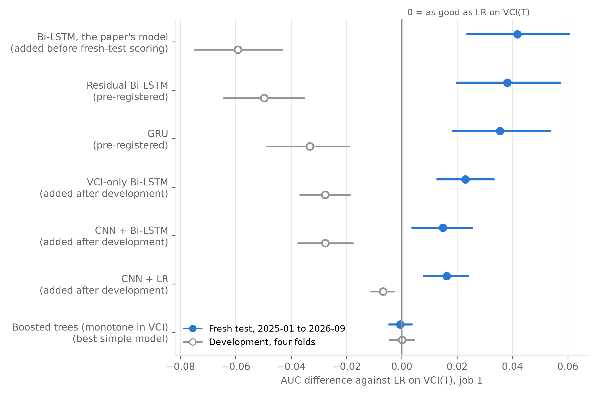

# DEWSat drought model: Bi-LSTM against logistic regression on VCI

Code, results and saved models of a pre-registered study for DEWSat, a Red/NIR CubeSat concept that estimates the
drought state of each 0.1-degree cell on board. The study asks whether a network that reads 12 months of satellite
inputs (a Bi-LSTM) ranks this month's soil-moisture drought better than logistic regression on this month's Vegetation
Condition Index, LR on VCI(T).

**Result.** On a one-time fresh test in 144 regions never used in development (target months 2025-01 to 2026-09), the
Bi-LSTM scored AUC 0.663 against LR's 0.621: +0.042 [+0.024, +0.060]. With four or five training years per fold in
development, every network trailed LR. The full write-up is [FINDINGS.md](FINDINGS.md).

The Bi-LSTM here is the plain network, the model the DEWSat paper uses. For job 1 it is not one of the pre-registered
rows: it was added to the fresh test before any fresh-test label was read (`code/design/DESIGN.md`, amendment 6). The
two pre-registered networks, the residual Bi-LSTM (LR on VCI(T) plus a Bi-LSTM correction) and the GRU, both passed the
rule fixed before training, and the three networks are within 0.006 AUC of each other on the fresh test.

| Question | Answer |
| --- | --- |
| Does the Bi-LSTM beat LR on VCI(T), job 1, fresh test? | Yes: +0.042 [+0.024, +0.060]. Pre-registered rows, both passed: residual Bi-LSTM +0.038 [+0.020, +0.057]; GRU +0.035 [+0.019, +0.054] |
| In development? | No: −0.059 [−0.075, −0.043] (residual Bi-LSTM −0.050 [−0.064, −0.035]) |
| Why the difference? | Years of training data: more years narrowed the gap, more regions did not |
| Judged by another soil-moisture model (NLDAS-2)? | The gain holds: +0.031 [+0.017, +0.044] |
| Judged by climatic drought (SPEI, 180 days)? | It reverses: −0.032 [−0.049, −0.013] |
| With single satellite passes? | +0.012 to +0.020 with a pass every 7 days, every interval including zero; none at 16 or 32 days. The residual Bi-LSTM and GRU keep +0.021 to +0.027 at 7 days |
| Model size | 11,617 parameters, 80,688 multiply-adds, 49.5 KiB per copy; the scored result averages 10 copies (seeds), about 495 KiB |

Brackets are 95% intervals from 2,000 resamples of whole regions.



## Repository layout

| Path | What it holds |
| --- | --- |
| `FINDINGS.md` | The findings: what was tested, every result, what it means, limitations |
| `results/` | The numbers and figures: `tables/` (CSV), `figures/` (PNG and PDF), `scores/` (every score file of the run, JSON); index in [results/README.md](results/README.md) |
| `paper_results/` | The paper's tables and figures, led by the Bi-LSTM, and the manuscript's claims checked against the results; index in [paper_results/README.md](paper_results/README.md) |
| `report.md` | The full report, every table of the run, generated from the score files |
| `data_card.md` | The data: products, regions, coverage, labels, sources and credits |
| `code/design/` | `DESIGN.md` and `gate.json`: the design and pass rule committed before training, with dated amendments 3-7 |
| `code/dewsat2/` | The pipeline: `run.py` (development stages, fresh test, Phase 6), `posthoc_run.py` (added models, learning curve, ReLU test), `nets.py`, `simple.py`, `scoring.py`, the report generators and `export_results.py` |
| `code/pull/` | Data download: HLS from NASA LP DAAC and Microsoft Planetary Computer, FLDAS from NASA GES DISC |
| `code/checks/`, `code/bench/`, `code/audit/` | Fold, feature and ReLU checks; timing benchmarks; the audit of the earlier run |
| `audit/` | The audit of the earlier run (Phase 0) and its numbers |
| `runs/phase5/` | The saved fresh-test models: `model.pt`, `meta.json` and predictions for every job, model and seed |

## Reproducing

Python 3.12 on macOS (Apple silicon) was used; the exact package versions are in `requirements.txt`.

```bash
python3.12 -m venv .venv && .venv/bin/pip install -r requirements.txt
source env.sh                     # from the repository root: keeps temp files and caches inside the repository
```

- **Tables and figures** from the score files: `python code/dewsat2/export_results.py`.
- **Reports** from the score files and data:
  `python -c "import sys; sys.path.insert(0, 'code/dewsat2'); import report; report.write_all()"`.
- **The whole run from scratch** needs the data (about 45 GB, not in this repository). Downloads use a NASA Earthdata
  login in `~/.netrc`; the region plan, the freeze and the pipeline stages are described in `code/design/DESIGN.md` and
  in the docstrings of `code/pull/pull_driver.py`, `code/dewsat2/run.py` and `code/dewsat2/posthoc_run.py`.
- **The fresh test** is locked: `code/dewsat2/phase5_stage.py` refuses to score it again once
  `data/locked/FRESH_TEST_SCORED.lock` exists.

## Data sources

- HLS v2.0 (Harmonized Landsat Sentinel-2), S30 and L30: NASA LP DAAC, and Microsoft Planetary Computer for 2020 onward.
- FLDAS Noah, `FLDAS_NOAH01_C_GL_M` v001, `SoilMoi10_40cm_tavg`: NASA GES DISC (the label).
- NLDAS-2 Noah, `NLDAS_NOAH0125_M` v2.0, `SoilM_10_40cm`: NASA GES DISC (label check).
- gridMET SPEI (Abatzoglou): climatic-drought benchmark.

Details and credits for earlier work are in [data_card.md](data_card.md).

## Not in this repository

- The downloaded data, features and image tiles (`data/`, `cache/`), and the runs other than the fresh-test models.
- Decision numbers (#n) in `DESIGN.md` and `report.md` refer to the project's internal decision log, kept with the
  working files.
- A license has not been chosen yet.
