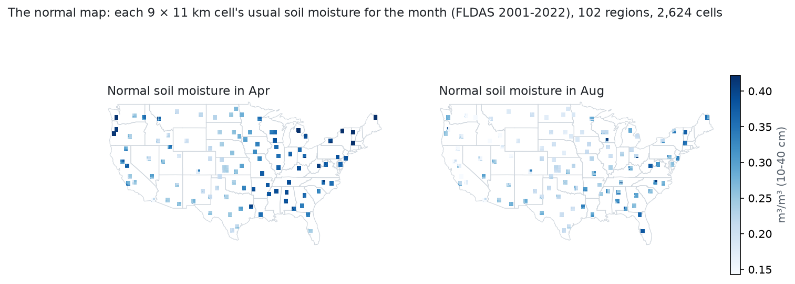
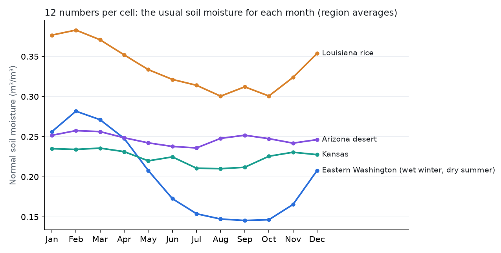
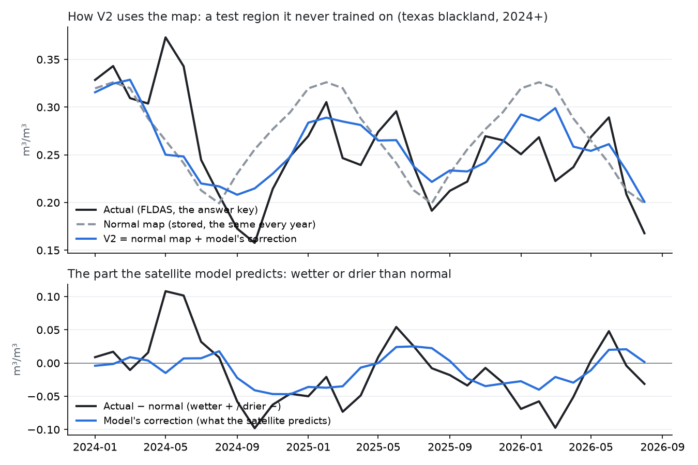
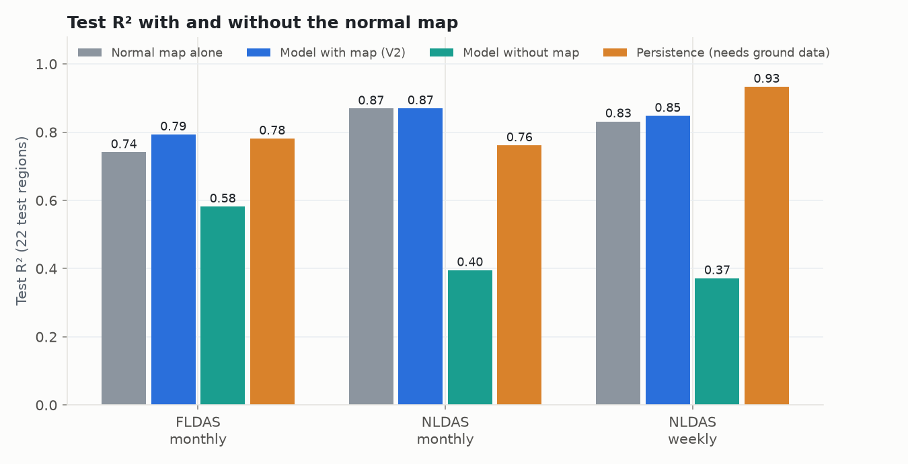

# The normal map

**What it is:** for every 0.1° cell (about 9 × 11 km), the usual soil moisture at 10–40 cm for each calendar month.
It is NASA FLDAS averaged over 2001–2022, so it is **12 numbers per cell**. It is built on the ground once and never
changes. It is not a model input, and it does not use anything the satellite measures.

## How V2 uses it

The satellite model does not predict soil moisture directly. It predicts **how much wetter or drier than normal** the
cell is this month, from what the satellite sees (NDVI, NDVI anomaly, VCI, season, location). The normal map is then
added back:

> soil moisture = normal map (stored) + model's correction (predicted from the satellite)

*(One test region the model never trained on. Scores over all 22 test regions are below.)*

## How much each part contributes (22 test regions, 2024+)

| | Test R² | Test RMSE (m³/m³) |
|---|---|---|
| Normal map alone (no satellite) | 0.74 | 0.0406 |
| **V2 = normal map + satellite correction** | **0.79** | **0.0363** |
| Persistence (last month's value; needs ground data the satellite does not have) | 0.78 | 0.0373 |

Most of the R² comes from the map. The satellite's correction brings V2 from 0.74 to 0.79, level with persistence. On its
own the correction is still weak: correlation 0.30 with the real wetter/drier-than-normal value.

## Without the map, the model does much worse

Trained again without the map: the model predicts soil moisture itself from the same satellite inputs, still with
season and location, so it could learn each place's usual pattern on its own. Same regions, 5 settings, picked on
validation. Tested with each answer key:

| Answer key, step (22 test regions) | With map R² | **Without map R²** | Normal map alone R² | Persistence R² |
|---|---|---|---|---|
| FLDAS, monthly (the mission model) | 0.79 | **0.58** | 0.74 | 0.78 |
| NLDAS, monthly | 0.87 | **0.40** | 0.87 | 0.76 |
| NLDAS, weekly | 0.85 | **0.37** | 0.83 | 0.93 |

- Without the map, the model is **worse than the map alone** every time, and worse than with the map in 20 of 22 test
  regions (FLDAS) and 22 of 22 (NLDAS).
- Why: from NDVI, season and location the satellite cannot tell how wet a given place's soil usually is. Two fields can
  look equally green with very different soil moisture. The map supplies that, and the satellite supplies the change.
- So the map is needed, but it can stay on the ground (next section). Full tables:
  [`model/report/nomap/results.md`](../report/nomap/results.md).

## Does it have to go on the satellite? No

| Option | On board | How it works |
|---|---|---|
| **A. Map stays on the ground** | 0 MB | The satellite sends down the correction (one small number per cell); the ground adds the map. |
| B. Map on board | see sizes below | The satellite sends down finished soil moisture in m³/m³. |

The answer is identical either way: adding the map is one addition per cell, wherever it happens.
Option A also lets the team update the map later (for example with newer years) without touching the satellite.

Sizes for option B (12 numbers per cell; 16-bit is accurate to about 0.0002 m³/m³, far below the model's error):

| Area | Cells | 16-bit | 32-bit |
|---|---|---|---|
| Our 102 regions | 2,624 | **61 KB** (`normal_map_float16.bin`) | 123 KB |
| Lower 48 US | ~82,000 | ~2 MB | ~4 MB |
| World land (estimate) | ~1.3 million | ~32 MB | ~64 MB |

For comparison, the model itself is about 13 KB of weights.

Separate from this map: to work out its inputs on board, the satellite needs each cell's usual NDVI and its lowest and
highest NDVI per month (3 more numbers per cell per month, about 3× the sizes above). Those are needed whether or not
the soil-moisture map goes up.

## Files

- `normal_map.csv`: region, split, longitude, latitude, month (1–12), normal soil moisture (m³/m³). One row per cell
  and month (31,488 rows).
- `normal_map_float16.bin`: the same values as an on-board table, 2,624 cells × 12 months, 16-bit floats, cells in the
  order of `normal_map.csv` sorted by region, longitude and latitude.
- Made by `model/make_normal_map.py`. It covers our 102 regions. A full-US map only needs FLDAS for the whole US, which
  is one more download.
